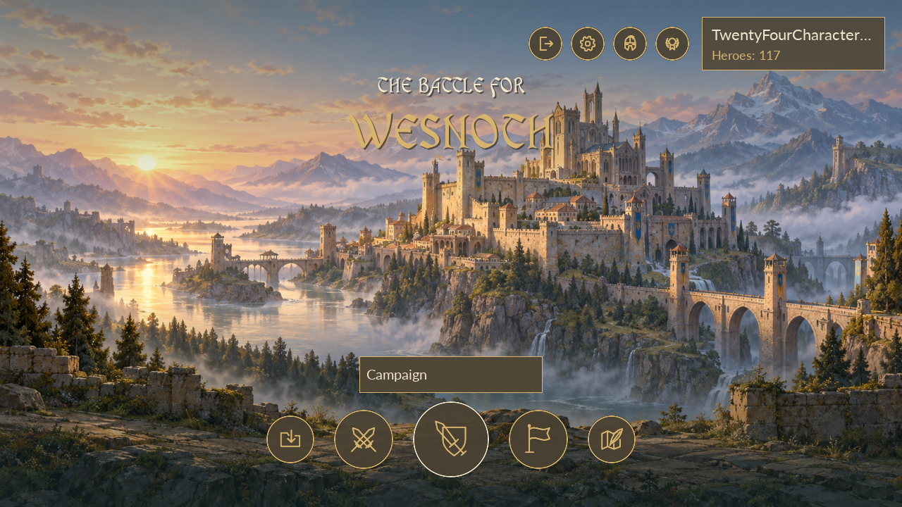

# Citadel menus — release 1192622

The home grid is replaced by a full-screen citadel at dawn, a centred WesScript title, an authenticated player panel and nine native icon buttons. The profile shows the username and owned character count, including zero; advancement forms do not inflate that count. No account-level value is invented.

At the 1280×720 reference size, the upper utility buttons are 52×52 in the order Quit, Preferences, My Heroes and Achievements. The bottom row is Load (72), Room (88), Campaign (112), Team (88), Map Editor (72), separated by 24 pixels on a centreline 96 pixels above the bottom. Scaling uses bounded one-eighth increments and cover-crops the background to fill larger displays. Action names appear on hover, keyboard focus or a held press; the full profile name appears on hover or hold. A held press describes the action without activating it on release.

The nine symbols are native Cairo-rendered gold outlines cached by symbol, rendered size, colour and pixel scale. They retain the existing destination callbacks and keyboard navigation. The profile refreshes from the authenticated account on return from menus; returning from gameplay uses the existing authentication gate.

These are actual VPS native-renderer captures with fixture accounts, not the player's saved values:

[Login preview](images/citadel-1192622-login-9f51983f3a8f.png) · [My Heroes preview](images/citadel-1192622-heroes-fe66f168d2c3.png)

## Shared artwork and theme

The generated [citadel artwork](../tools/native-account-game/ui-assets/background/citadel-dawn.png) contains no text or controls. Its exact generated bytes are stored separately from the unchanged OBB and covered by the existing interface manifest. The prompt and provenance are recorded in [PROVENANCE.md](../tools/native-account-game/ui-assets/PROVENANCE.md).

[ui-theme.json](../tools/native-account-game/ui-theme.json) is the shared source for background, title, gold/ivory/stone/teal palette and the existing WesScript/Lato font hashes. Generated native and Android constants keep loading, authentication and home consistent. The APK bundles only public trust, interface assets and the two verified fonts; it retains the original package identity and signer.

Native menu definitions are cloned inside a scoped menu context for both default and Celes. Construction and nested dialogs inherit the context; original GUI definitions remain unchanged outside it. Warm panels, larger readable text and touch controls apply to Campaign, Room, Team, Load, My Heroes, Achievements and Preferences. Portraits, minimaps and faction colours remain intact. Gameplay HUD and editor canvas use their original definitions.

Preferences keeps its title and Close button fixed while its existing content scrolls. All six navigation tabs are visible initially; nested tabs and dynamically created Advanced/Hotkeys controls receive the same touch sizing and colours. The native Load list also reserves enough width for its sorting controls, including when there are no saves.

Login and Signup retain the existing replacement-form navigation, keyboard handling and session rules. Quit and authentication X retain bounded logout, local session clearing and Android task closure. Required local-server loss returns to Login; WAN connectivity is not an authentication dependency.

## Delivery and evidence

This release changes client presentation and delivery only. The network protocol, schema 3, account data, heroes, rewards, campaign checkpoints and server services are unchanged. The previous completed Android stages and recovery journals are retained by the normal rebuild helper.

Use [CITADEL_ACCEPTANCE_1192622.md](CITADEL_ACCEPTANCE_1192622.md) for the single Windows client update and ordered UI checks. [VERIFICATION_1192622.json](VERIFICATION_1192622.json) records the final VPS results and their scope. Native software-renderer captures and injected GUI events do not establish physical keyboard/touch or Android framework rendering in LDPlayer.

The accepted 1192621 A–M observations remain historical evidence, with startup failure Retry/Close still NOT RUN and empty-Owned guidance still open feedback. After the affected UI checks pass, resume pending N from the existing campaign saves; do not restart the campaign or repeat unrelated accepted tests.
