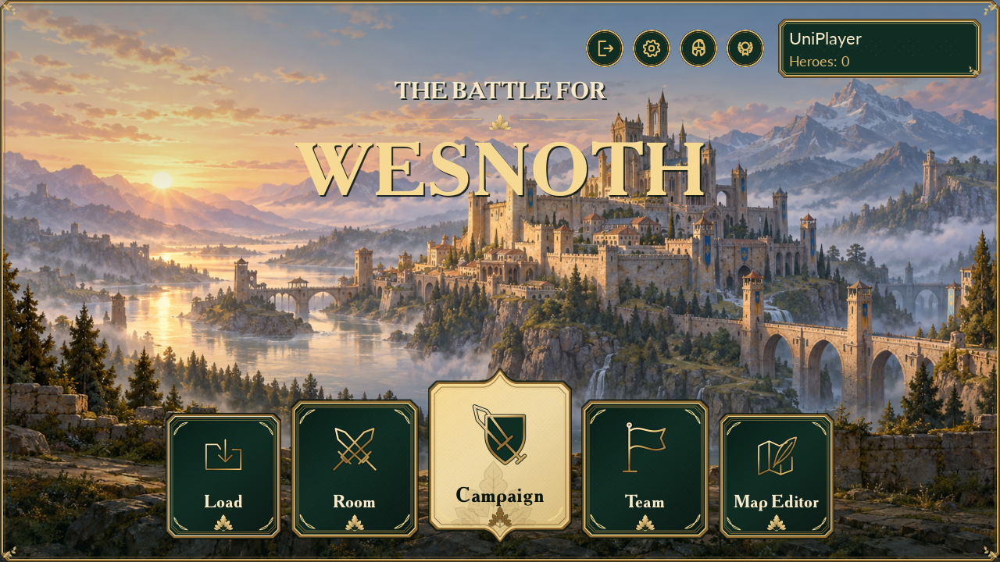
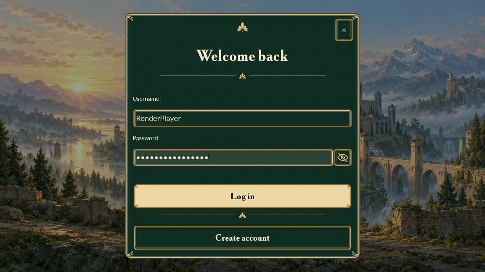

# Emerald Court — release1192623

The uploaded [Emerald Court concept](design/emerald-court-reference.png) is the visual reference. The concept-sheet heading and its example username are not application content. Existing product destinations remain Load, Room, Campaign, Team and Map Editor; the upper utilities remain Quit, Preferences, My Heroes and Achievements.

The reference replaces the1192622 circular bottom navigation with labeled emerald plaques, ornamental gold borders and a larger parchment Campaign centerpiece. The home title uses the bundled Akademie Alte serif, with Lato retained for readable dynamic interface text. The live profile continues to show username and owned canonical-character count; it does not count advancement forms or invent a player level.

Login and Signup use the same painted scene and framed emerald panel, leaf ornaments, gold primary action, dark green text fields and cream typography. Existing replacement-form navigation, password visibility, physical-keyboard fix, bounded logout/task closure and required-local-server recovery remain intact.

Shared decoration is rendered through the existing Cairo/libpng dependencies with cached chrome. Native default and Celes menu controls receive the same palette and ornament treatment, including Campaign, Room, Team, Load, My Heroes, Achievements, Preferences and nested dialogs. The original citadel artwork is reused byte-for-byte; no generated screenshot is substituted for interactive controls. Maps, units, gameplay HUD and editor canvas keep their existing rendering and controls.

This changes client presentation only: package/signing identity, public configuration, protocol3, wire release1192621, schema3, server APIs, campaign rewards and saved state remain unchanged. The normal1192623 rebuild retains completed1192622 stages and historical recovery journals. Existing five server services may stay running.

Follow [EMERALD_ACCEPTANCE_1192623.md](EMERALD_ACCEPTANCE_1192623.md) for the client-only update and ordered UI checks. Windows/LDPlayer visual acceptance is pending. Preserve historical1192621 A–M acceptance and its limits; resume N using the existing campaign saves after this UI batch passes.

## Actual native previews

These are unedited captures from the final Linux GUI2 renderer at1280×720, using fixture account values. They show the implemented controls; they are not LDPlayer screenshots or current player state.

[Signup preview](previews/emerald-signup-1280.png). Native captures at1920×1080, both native interface themes, long-name/zero/117-hero edge cases and the full foreground-layout checks are bound in `build/audit-emerald-ui-1192623/validation.json`. The additional68 real authentication/Preferences captures are bound in `build/audit-emerald-preferences-1192623/verification.json`. Windows visual acceptance remains separate.
